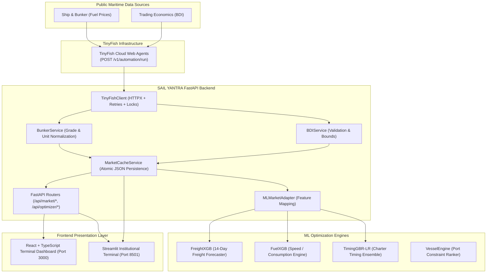

#  SAIL YANTRA — Maritime Intelligence & Chartering Decision Support Desk

> **Autonomous AI-Driven Maritime Chartering & Predictive Analytics Platform**  
> Integrated with **TinyFish Autonomous Web Agents** for Live Baltic Dry Index (BDI) and Marine Bunker Fuel Price Ingestion.

---

## 1. Project Overview

**SAIL YANTRA** is an enterprise-grade commercial maritime chartering, freight rate forecasting, and voyage optimization platform designed for dry-bulk raw material procurement (e.g. coking coal, iron ore, and limestone for Steel Authority of India Limited and global steelmakers).

### The Problem
International ocean dry-bulk freight rates and bunker fuel costs are notoriously volatile, subject to macroeconomic swings, geopolitical bottlenecks (e.g. Suez/Panama canals, port strikes), and regional weather patterns. Chartering desks frequently fix vessels too early or too late, incurring millions of dollars in avoidable freight premiums, bunker fuel surcharges, and discharge port demurrage.

### The SAIL YANTRA Solution
SAIL YANTRA unifies predictive machine learning with autonomous real-time web intelligence:
- **Freight Rate Forecaster (`FreightXGB`)**: Forecasts route-specific freight rates ($/tonne) 14 days forward with uncertainty bands.
- **Bunker Fuel & Speed Optimizer (`FuelXGB`)**: Models fuel consumption (TPD) across draft, speed, and weather to minimize voyage fuel cost and avoid laycan delay penalties.
- **Charter Timing Ensemble (`TimingGBR-LR`)**: Evaluates forward market trajectories to deliver a crisp **`EXECUTE FIXTURE [T+0]`** vs. **`DEFER FIXTURE [T+n TARGET]`** recommendation.
- **Vessel Allocation Ranker (`VesselEngine`)**: Ranks candidate vessels against port physical constraints (draft, DWT, beam, queue days).
- **TinyFish Market Intelligence Desk**: Autonomously extracts live market benchmarks (Baltic Dry Index and Bunker fuel prices) from public web sources without fragile, brittle scrapers.

---

## 2. TinyFish Integration

### Why TinyFish?
Traditional web scrapers (BeautifulSoup, Selenium, Playwright) break whenever financial websites adjust their layout, update CSS classes, or render dynamic JavaScript. **TinyFish** provides infrastructure for autonomous LLM web agents. Instead of brittle selectors, SAIL YANTRA dispatches natural-language goals:
- *"Extract the latest Baltic Dry Index value, point change, percentage change, and reporting date. Return JSON."*
- *"Extract bunker fuel prices for major ports including Singapore and Rotterdam for fuel grades VLSFO, HSFO, and MGO in USD per metric ton. Return JSON."*

TinyFish handles headless browser rendering, anti-bot mitigation, and returns strict, validated JSON matching our Pydantic schemas.

### Maritime Data Sources
1. **Baltic Dry Index (BDI)**: [Trading Economics Commodity Baltic](https://tradingeconomics.com/commodity/baltic) — The global benchmark for dry bulk charter rates.
2. **Marine Bunker Fuel Prices**: [Ship & Bunker Global Prices](https://shipandbunker.com/prices) — Industry standard benchmark quotes across major maritime hubs (Singapore, Rotterdam, Fujairah, Houston).

---

## 3. Architecture & Data Flow



---

## 4. Features Implemented

### Feature 1 — Baltic Dry Index (BDI) Extraction
- **Live Ingestion**: Connects to TinyFish to extract real-time BDI quote, point change, percentage change, and reporting date.
- **Validation**: Enforces numeric bounds ($50 \le \text{BDI} \le 30{,}000$ points) and rejects non-numeric or corrupt payloads.
- **Freshness Lifecycle**: Categorizes quotes as `fresh` (< TTL), `stale` (>= TTL), or `fallback`.
- **Fault-Tolerant Cache**: If a live sync fails, previously valid data is preserved and served with a stale badge.

### Feature 2 — Bunker Fuel Price Extraction
- **Multi-Port Coverage**: Singapore, Rotterdam, Fujairah, Houston, Mumbai.
- **Grade Enforcement**: Strictly validates fuel categories (`VLSFO`, `HSFO`, `MGO`) and prevents cross-contamination.
- **Unit Normalization**: Guarantees quotes are standardized to `USD/MT`.
- **Benchmark Selection**: Automatically isolates Singapore VLSFO as the primary chartering calculation benchmark.

### Feature 3 — ML Compatibility & Voyage Optimization
- Seamlessly injects live BDI and Bunker values into `optimizer.py:run_optimization()` without altering trained model dimensions or feature schemas.
- Computes Total Landed Cost (TLC) breakdown: Base Freight + Bunker Surcharge + Demurrage Risk + Inventory Carrying Cost.
- Produces optimal charter timing decisions ($T+0$ vs $T+n$ target) and calculated net savings ($).

---

## 5. API Reference

### Market Intelligence Endpoints

| Method | Endpoint | Description |
| :--- | :--- | :--- |
| `GET` | `/api/market/bdi` | Returns latest Baltic Dry Index value, changes, reporting date, and freshness metadata. Supports `?force_refresh=true`. |
| `GET` | `/api/market/bunker-prices` | Returns port-specific bunker fuel quotes and Singapore VLSFO benchmark in USD/MT. Supports `?force_refresh=true`. |
| `POST` | `/api/market/sync` | Manually triggers TinyFish extraction for `all`, `bdi`, or `bunker`. Protected by debounce rate limiting and optional token. |
| `GET` | `/api/market/sync/status` | Returns synchronization health, active sync state, last extracted timestamps, and cache status. |
| `GET` | `/api/market/summary` | Combined summary aggregating BDI, bunker benchmarks, and ML model readiness. |

### ML Optimizer Endpoints

| Method | Endpoint | Description |
| :--- | :--- | :--- |
| `GET` | `/api/optimizer/live-params` | Formats current live market intelligence directly for ML model consumption. |
| `POST` | `/api/optimizer/run` | Executes the complete SAIL YANTRA ML pipeline with live market data automatically injected. |
| `GET` | `/api/health` | System health check reporting cache persistence and TinyFish configuration status. |

---

## 6. Installation & Quick Start

### Prerequisites
- Python 3.11+
- Node.js v18+ & npm (for React frontend)

### 1. Backend Setup
```powershell
# In project root:
pip install -r requirements.txt
```

### 2. Configure Environment (.env)
Copy the template and configure your TinyFish API key:
```powershell
copy .env.example .env
```
Edit `.env`:
```ini
TINYFISH_API_KEY=tf_your_actual_api_key_here
TINYFISH_BASE_URL=https://agent.tinyfish.ai
MARKET_CACHE_TTL_SECONDS=14400
```
*(Note: If `TINYFISH_API_KEY` is omitted, the system operates in fallback persistence mode, serving validated baseline data.)*

### 3. Launch Backend Server
```powershell
python run_backend.py
# Server running at http://127.0.0.1:8000
# OpenAPI Swagger UI docs: http://127.0.0.1:8000/docs
```

### 4. Launch React Frontend
```powershell
cd frontend
npm install
npm run dev
# Dashboard running at http://localhost:3000
```

### 5. Launch Streamlit Institutional Terminal (Alternative)
```powershell
streamlit run app.py
# Terminal running at http://localhost:8501
```

---

## 7. Testing & Verification

### Automated Backend Test Suite
Runs all 12 required test scenarios (auth, extraction, bounds validation, timeouts, rate-limiting, persistence, ML compatibility):
```powershell
pytest tests/test_tinyfish_integration.py -v
```

### Automated Frontend Test Suite
Runs Vitest unit tests for the React API client and error handling:
```powershell
cd frontend
npm test
```

### Production Build Verification
Verifies TypeScript compilation and bundle generation:
```powershell
cd frontend
npm run build
```

### Live TinyFish Cloud Diagnostics
Tests real live connectivity against TinyFish:
```powershell
python scripts/verify_live.py
```

---

## 8. Hackathon Evaluation & Commercial Model

### Practical Value & ROI
For a steelmaker chartering 15 Capesize/Panamax vessels per month (e.g., 60,000 MT coal shipments from Australia to Vizag):
- A **$1.50/tonne reduction** in freight via optimal charter timing yields **$90,000 savings per voyage** ($1.35M annually).
- Real-time bunker fuel surcharge calibration avoids up to **$25,000 in fuel discrepancy claims per fixture**.

### Commercial SaaS Model
1. **Tier 1 (Chartering Desk SaaS)**: $4,500/month per terminal seat — automated market ingestion, freight prediction, timing engine.
2. **Tier 2 (Enterprise API)**: $12,000/month — webhook-driven TinyFish synchronization, ERP/SAP integration, bespoke vessel rankers.
3. **Gainshare Model**: 5% of verified demurrage and freight savings achieved via the timing engine.

---

## 9. 2–3 Minute Hackathon Demo Script

- **[0:00 - 0:30] The Challenge**:  
  *"Steel mills like SAIL import millions of tonnes of coal and iron ore. Commercial chartering teams face extreme market volatility. Fixing a vessel just 3 days off-peak can cost $100,000+ in excess freight and bunker surcharges."*
- **[0:30 - 1:00] TinyFish Live Intelligence**:  
  *"Traditional scrapers fail when financial portals change layouts. We integrated TinyFish autonomous web agents. With simple natural-language prompts, TinyFish browses Trading Economics and Ship & Bunker, extracting live Baltic Dry Index and bunker fuel prices into our FastAPI backend."*
- **[1:00 - 1:45] The Terminal in Action**:  
  *"On our dashboard, we see live BDI at 1,845 points and Singapore VLSFO at $648.5/MT, complete with freshness tags and source attribution. Clicking 'Sync Now' triggers an agent run with automatic concurrency protection and rate-limit backoff."*
- **[1:45 - 2:30] End-to-End Decision Support**:  
  *"We select a voyage from Dampier to Vizag with 60,000 MT of coking coal. Our ML engine auto-binds the live market intelligence. The timing ensemble evaluates rate momentum and recommends 'DEFER FIXTURE to T+6', saving an estimated $120,000 in total landed cost. That is autonomous intelligence directly driving commercial maritime procurement."*

---

## 10. Limitations & Disclosures

- **Publication Cycles**: The Baltic Dry Index is published once daily on London business days by the Baltic Exchange; bunker fuel quotes update during regional trading desk sessions.
- **Live Credentials**: Full live cloud extraction requires an active `TINYFISH_API_KEY`. When unconfigured, the platform defaults to verified persisted cache entries to guarantee high availability.
